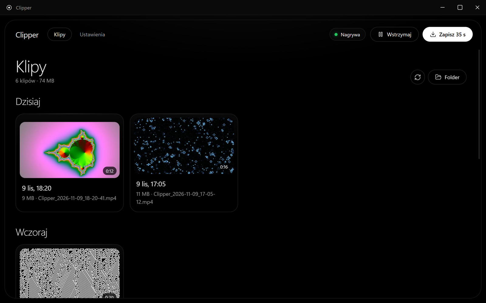
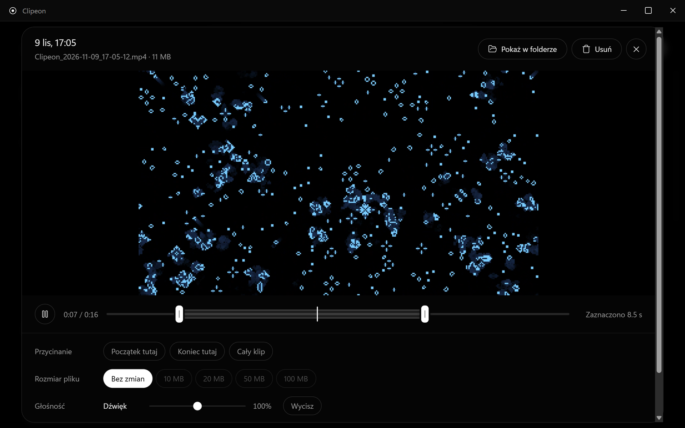
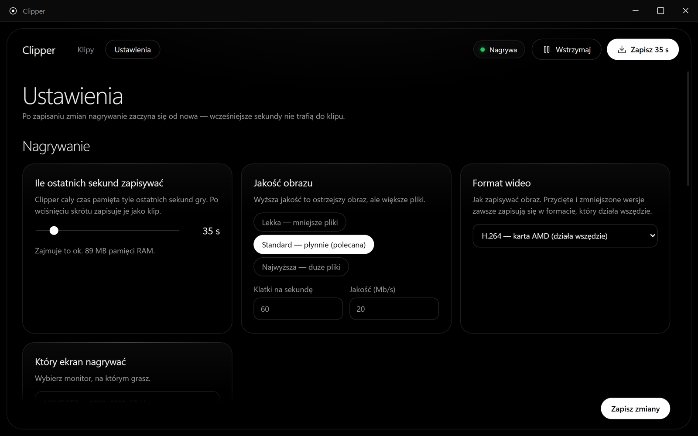
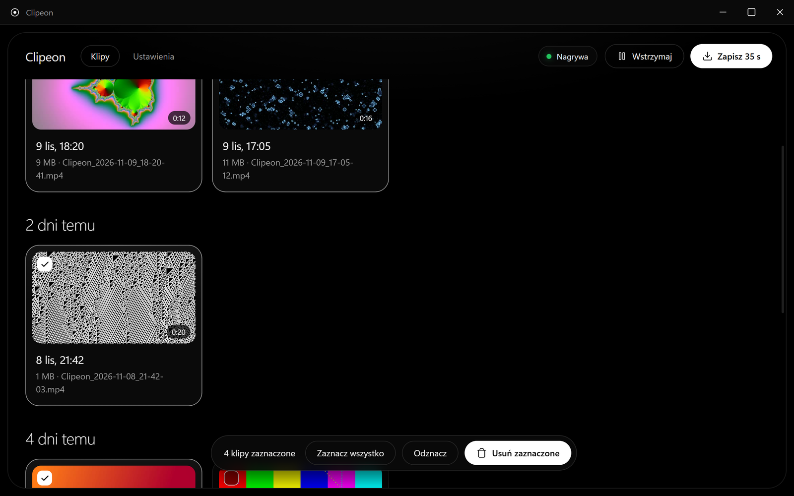

  

<h1 align="center">Clipper</h1>

  Lekkie nagrywanie powtórek z gier dla Windows. Clipper cały czas pamięta ostatnie sekundy gry, 
  a po wciśnięciu skrótu zapisuje je jako klip — bez nagrywania wszystkiego na dysk.

  <a href="https://github.com/Atsuieon/Clipper/releases/latest"><b>Pobierz instalator</b></a> ·
  <a href="#english">English</a>

## Co potrafi

- **Powtórka jednym skrótem** — ostatnie 10–300 s (domyślnie 30 s) zapisuje się po wciśnięciu **Alt+F10**, w ~0,3 s,
  bez przerywania nagrywania. Ostatnie sekundy są trzymane w pamięci RAM (np. 30 s ≈ 80 MB), nie na dysku.
- **Kodowanie na karcie graficznej** — AMD (AMF), NVIDIA (NVENC) i Intel (Quick Sync) wykrywane automatycznie;
  gdy karta nie działa, awaryjnie procesor. Formaty H.264, HEVC i AV1. Obciążenie procesora ~2%.
- **Dźwięk z gry i mikrofon** na osobnych ścieżkach (plus wspólny miks), więc w edytorze możesz ściszyć jedno albo drugie
  albo wyciąć swój głos.
- **Biblioteka** z podziałem na dni, miniaturami, zaznaczaniem wielu klipów (Ctrl / Shift) i usuwaniem do Kosza.
- **Edytor** — przycinanie, zmniejszanie do **10 / 20 / 50 / 100 MB** (np. pod Discorda), głośność gry i mikrofonu.
  Gotowy klip przeciągasz prosto do Discorda, Eksploratora albo przeglądarki.
- **Potwierdzenie w grze** — krótki dźwięk i dymek w rogu ekranu, który nie zabiera fokusu z gry.
- **Nie przestaje nagrywać po cichu** — strażnik sam wznawia nagrywanie po awarii sterownika, zmianie rozdzielczości
  czy uśpieniu komputera, a gdy to się nie uda, pokazuje alarm. Wszystko trafia do dziennika zdarzeń.
- **Automatyczne porządki** (opcjonalnie) — stare klipy trafiają do Kosza po X dniach albo po przekroczeniu X GB.

| Edytor | Ustawienia |
| --- | --- |
|  |  |

## Wymagania

- Windows 10 (2004 lub nowszy) albo Windows 11, 64-bit.
- Karta graficzna ze sprzętowym kodowaniem wideo (AMD Radeon RX 400 lub nowsza, NVIDIA GTX 600 lub nowsza,
  Intel HD Graphics 500 lub nowsza) — bez niej Clipper koduje procesorem, co mocniej obciąża komputer.
- Gra w trybie **okna bez ramki** (borderless) — wtedy widać też dymek po zapisie. Pełny ekran wyłączny też jest nagrywany.

## Instalacja

1. Pobierz `Clipper_x.y.z_x64-setup.exe` z [Releases](https://github.com/Atsuieon/Clipper/releases/latest).
2. Uruchom instalator i przejdź przez kolejne kroki (nie wymaga uprawnień administratora).
3. Clipper startuje w zasobniku obok zegara. Lewy klik na ikonie otwiera bibliotekę, prawy — menu.

> **Ostrzeżenie SmartScreen:** instalator nie jest podpisany certyfikatem (to płatna usługa), więc Windows może
> pokazać „System Windows ochronił ten komputer”. Kliknij **Więcej informacji → Uruchom mimo to**.
> Kod jest otwarty, a instalator budowany automatycznie przez GitHub Actions z tego repozytorium.

FFmpeg jest w zestawie — nie trzeba niczego doinstalowywać.

## Skróty i obsługa

| Co | Jak |
| --- | --- |
| Zapisz ostatnie sekundy | **Alt+F10** (do zmiany w Ustawieniach) |
| Otwórz bibliotekę | lewy klik na ikonie przy zegarze |
| Wstrzymaj nagrywanie, ustawienia, dziennik | prawy klik na ikonie |
| Zaznacz kilka klipów | Ctrl + klik, Shift + klik (zakres), Esc — odznacz |
| Przeciągnij klip do innego programu | złap kartę albo podgląd w edytorze |
| Odtwórz / pauza w edytorze | spacja albo klik w podgląd |

Kolor kropki przy zegarze: zielona — nagrywa, żółta — wznawia nagrywanie, czerwona — nie nagrywa (najedź, żeby
zobaczyć powód), szara — wstrzymane.

## Gdzie co jest

| Co | Gdzie |
| --- | --- |
| Klipy | `Wideo\Clipper` (do zmiany w Ustawieniach) |
| Ustawienia | `%APPDATA%\Clipper\config.toml` |
| Dziennik zdarzeń | `%APPDATA%\Clipper\logs\clipper.log` (menu ikony → „Pokaż dziennik zdarzeń”) |
| Miniatury (pamięć podręczna) | `%LOCALAPPDATA%\pl.clipper.app\miniatury` |
| Program | `%LOCALAPPDATA%\Clipper` |

Odinstalowanie nigdy nie usuwa klipów.

## Prywatność

Clipper działa wyłącznie na Twoim komputerze. Klipy, nagrania i ustawienia nigdy nie są nigdzie wysyłane.
Nie ma telemetrii ani analityki. Jedyne połączenie z internetem to raz dziennie zapytanie do GitHuba, czy jest nowa
wersja (Ustawienia → Aktualizacje — można wyłączyć).

## Znane ograniczenia

- Instalator nie jest podpisany — patrz ostrzeżenie SmartScreen wyżej.
- Karty AMD Radeon RX 7000 kodują AV1 w rozdzielczości 1920×1082 (2 czarne linie na dole) — ograniczenie sprzętu.
- Podgląd klipów HEVC w aplikacji wymaga rozszerzenia „HEVC Video Extensions” z Microsoft Store.
- Dymek po zapisie nie jest widoczny nad grami w trybie pełnoekranowym wyłącznym (dźwięk działa).
- Nagrywany jest jeden wybrany monitor.

## Plany

- Wybór okna gry zamiast całego monitora.
- Znaczniki w trakcie gry i zapis kilku momentów naraz.
- Format pionowy 9:16 i łączenie klipów.

## Licencja

Clipper: [MIT](LICENSE) © 2026 Atsuieon. FFmpeg w instalatorze: LGPL 2.1+ — szczegóły w
[THIRD_PARTY_NOTICES.md](THIRD_PARTY_NOTICES.md).

---

## English

**Clipper** is a lightweight instant-replay recorder for Windows games. It keeps the last seconds of gameplay in RAM
(encoded on your GPU) and saves them as an MP4 when you press **Alt+F10** — no constant recording to disk.

- GPU encoding with auto-detection: AMD AMF, NVIDIA NVENC, Intel Quick Sync (CPU fallback); H.264 / HEVC / AV1.
- Game audio and microphone on separate tracks; per-track volume and "without my voice" export.
- Library with date sections, multi-select and Recycle Bin delete; editor with trimming and "shrink to 10/20/50/100 MB";
  drag a clip straight into Discord, Explorer or a browser.
- Watchdog that restarts recording after driver crashes, resolution changes or sleep, with alerts and an event log.
- **Install:** download the setup from [Releases](https://github.com/Atsuieon/Clipper/releases/latest). The installer
  is not code-signed, so SmartScreen may warn — click *More info → Run anyway*. FFmpeg is included.
- **Requirements:** Windows 10 2004+ / 11 (64-bit), a GPU with hardware video encoding recommended.
- **Privacy:** everything stays on your PC. The only network request is a daily update check against GitHub
  (can be turned off). No telemetry.
- **Files:** clips in `Videos\Clipper`, settings in `%APPDATA%\Clipper\config.toml`, log in `%APPDATA%\Clipper\logs`.
- **Build:** `cargo install tauri-cli --version "^2"` then `cargo tauri build`.
- **License:** MIT © 2026 Atsuieon; bundled FFmpeg is LGPL 2.1+ (see THIRD_PARTY_NOTICES.md). The UI is in Polish.
