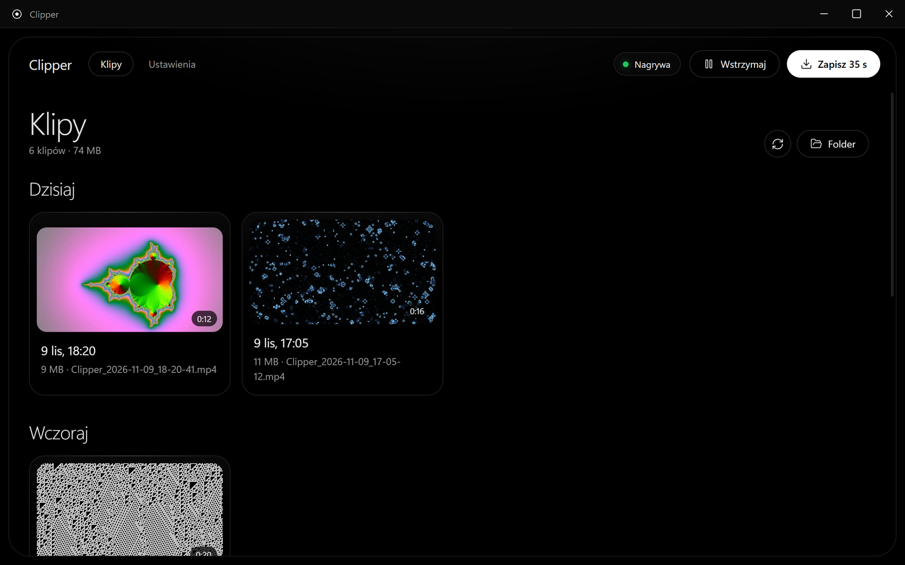
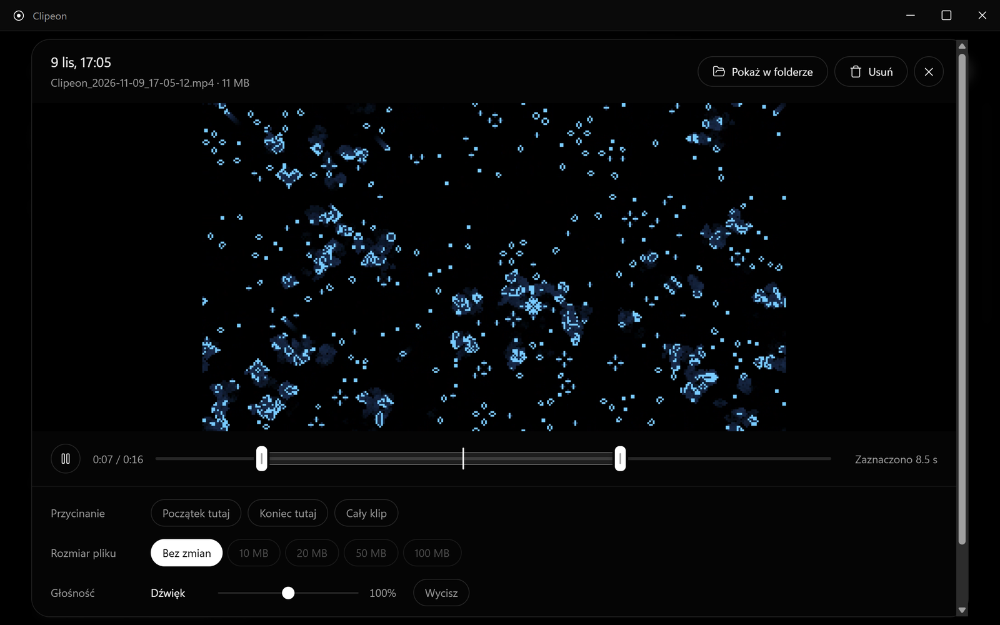
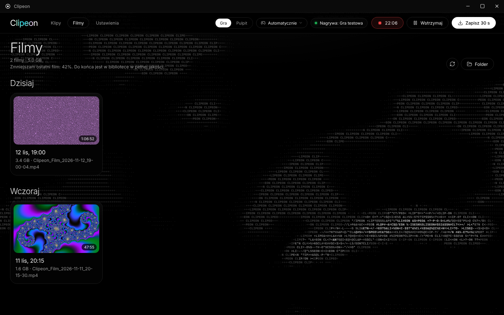
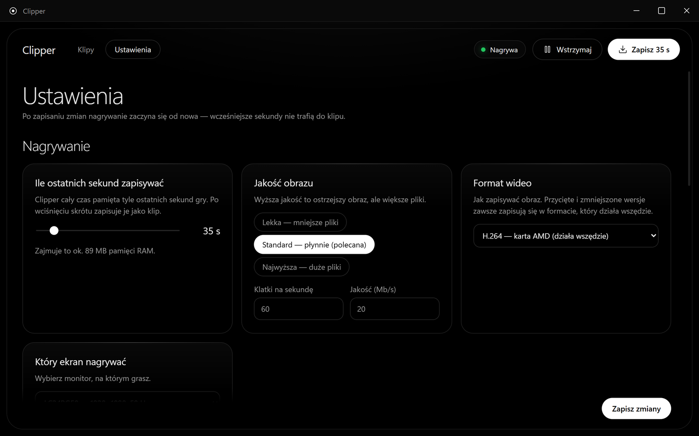

  

<h1 align="center">Clipeon</h1>

Save the best moments of your games with one shortcut — without recording everything to disk.

  
  

<a href="#po-polsku">🇵🇱 Po polsku — niżej</a>

<table>
  <tr>
    <td width="33%">
Editor
</td>
    <td width="33%">
Films
</td>
    <td width="33%">
Settings
</td>
  </tr>
</table>

## Features

- **The last seconds of your game with one shortcut** — press **Alt+F10** and the last 30 s (adjustable from 5 s to 10 min) are saved as an MP4.
- **Save a clip by voice** (a troll option, very buggy — more of a joke than a real feature) — say your own phrase, e.g. "record video", and Clipeon saves a clip. You teach it by saying the phrase 3 times, so any accent or language works. Off by default; runs offline on your PC at about 0.1% of one CPU core.
- **Films** — "Record film" or **Alt+F9** records with no time limit until you press it again. A film adds no extra load on the game, and clips keep working while it records. Films have their own tab. **Alt+F8** during a film adds a marker you can jump to in the editor, and a film cut short by a crash is put back together on the next start.
- **Smaller films** — after recording, Clipeon can re-encode the film in the background as HEVC (about half the size) or AV1 (about a third). The graphics card does the work.
- **Lightweight** — the graphics card (AMD, NVIDIA, Intel) captures and encodes the picture; nothing touches the disk until you save.
- **Desktop mode** — the "Game | Desktop" switch in the top bar: the desktop has its own screen and lighter settings (30 FPS, 12 Mb/s by default), and you pick the screen with one click.
- **Game, Discord and mic separately** — the editor has three tracks with a waveform: "Game", "Discord and the rest" and "Microphone". Turn each one down or mute it and hear the result right away.
- **Editor** — trimming, cropping, shrinking to 10 / 20 / 50 / 100 MB and saving as a looping GIF / WebP, e.g. for Discord. `←` / `→` skip 5 s, `,` / `.` step one frame.
- **Record only the game** — after Alt+Tab the picture stays on the last frame of the game, so Discord or your browser never end up in a clip.
- **Drag or copy** — drag a finished clip straight into Discord, a browser or a folder, or click "Copy" and paste with Ctrl+V.
- **Library** — clips grouped by day, select many at once, delete to the Recycle Bin.
- **Doesn't silently stop recording** — it resumes on its own after a driver problem, switches to another capture method when one fails, and warns you when something is wrong.
- **English or Polish** — picked from the Windows language on first start; change it in Settings → System → Language.

## Requirements

- Windows 10 (version 2004 or newer) or Windows 11, 64-bit
- Recommended: AMD Radeon RX 400+, NVIDIA GTX 600+ or Intel HD 500+ graphics (without one Clipeon encodes on the CPU)

## Quick start

1. Download `Clipeon_x.y.z_x64-setup.exe` from the [latest release](https://github.com/Atsuieon/Clipeon/releases/latest) and install it.
2. Clipeon runs in the background — its icon sits in the taskbar next to the clock. The dot is green while it records.
3. Play and press **Alt+F10** when something worth keeping happens. Clicking the icon opens the clip library.
4. Want the whole session? Press **Alt+F9** at the start and again at the end. The film is in the **Films** tab.

## FAQ

<b>Windows says "Windows protected your PC".</b>

The installer isn't signed with a paid certificate, so SmartScreen doesn't know it. Click **More info → Run anyway**.
The installer is built automatically from the code in this repository.

<b>Clips don't save: "Windows blocked ffmpeg" / "An Application Control policy has blocked this file".</b>

Windows 11 **Smart App Control** (or a work/school policy) won't start the unsigned ffmpeg that Clipeon uses to save clips. It has no per-app exceptions.
What to do: [Windows blocks ffmpeg](docs/windows-blokuje-ffmpeg.md#windows-blocks-ffmpeg-an-application-control-policy-has-blocked-this-file).

<b>Where are my clips?</b>

In `Videos\Clipeon`, in a subfolder for the month (e.g. `2026-11`); older clips sit directly in the folder. You can change the folder in Settings.
Uninstalling never deletes clips.

<b>How do I change a shortcut?</b>

Settings → Shortcuts. Click the field and press the new key combination.
Clipeon's shortcuts are off while you set one, so nothing gets saved by accident.

<b>How do I record the desktop instead of a game?</b>

Click **Desktop** in the bar at the top of the window (or "Mode: Desktop" in the taskbar icon menu). Pick the screen next to it.
The desktop has its own card in Settings → Recording quality (next to the Game card), so switching doesn't change your game settings.
Desktop clips are named `Clipeon_Pulpit_…` and have a "Desktop" badge in the library.

<b>Films take up a lot of space.</b>

In Settings → Recording quality → Films pick a smaller option (HEVC is about half the size, AV1 about a third).
After a recording ends Clipeon re-encodes the film in the background; until then the full-quality film is in the library.
The options only appear if your graphics card supports the format.

<b>Something doesn't work — how do I report a bug?</b>

Settings → Advanced → Reporting problems → **Copy diagnostics** and paste the text into an [issue](https://github.com/Atsuieon/Clipeon/issues/new/choose).
Diagnostics describe your graphics card, monitors, settings and recent events. Nothing is sent automatically.

<b>I used Clipper — what now?</b>

Clipeon is the same app under a new name. Install it: the installer removes Clipper, and your settings, autostart and clips stay.

**Privacy:** everything stays on your computer — the only internet connection is the update check on GitHub (you can turn it off).

## Support

Clipeon is free and will stay that way — no ads and no paid features. If it's useful to you and you'd like to help, you can buy me a coffee on Ko-fi (the button is also at the bottom of Settings in the app):

## License

[MIT](LICENSE) © 2026 Atsuieon. FFmpeg in the installer: LGPL 2.1+ — see [THIRD_PARTY_NOTICES.md](THIRD_PARTY_NOTICES.md).

---

## Po polsku

Clipeon trzyma w pamięci ostatnie sekundy gry i zapisuje je jako MP4, gdy wciśniesz **Alt+F10** (długość od 5 s do 10 min).
**Alt+F9** nagrywa film bez limitu czasu (**Alt+F8** dodaje w nim znacznik), a po nagraniu może go w tle zmniejszyć do HEVC albo AV1.
Obraz przechwytuje i koduje karta graficzna (AMD / NVIDIA / Intel). Do tego tryb pulpitu, osobne ścieżki gry, Discorda i mikrofonu,
edytor (przycinanie, kadrowanie, zmniejszanie pod Discorda, GIF / WebP), przeciąganie i kopiowanie klipów do innych programów
oraz „Nagrywaj tylko grę”, które po Alt+Tab zatrzymuje obraz na ostatniej klatce gry. Windows 10 2004+ / 11.

**Jak zacząć:** pobierz instalator z [najnowszego wydania](https://github.com/Atsuieon/Clipeon/releases/latest), zainstaluj i graj — Clipeon działa w tle przy zegarze (zielona kropka = nagrywa).
Klik w ikonę otwiera bibliotekę klipów, a język zmienisz w Ustawienia → System → Język.

- **„System Windows ochronił ten komputer”** — instalator nie jest podpisany płatnym certyfikatem: **Więcej informacji → Uruchom mimo to**.
- **„Windows zablokował ffmpeg” / „Zasady kontroli aplikacji zablokowały ten plik”** — to Smart App Control w Windows 11; co zrobić: [Windows blokuje ffmpeg](docs/windows-blokuje-ffmpeg.md).
- **Gdzie są klipy?** — w `Wideo\Clipeon`, w podfolderze z miesiącem. Odinstalowanie nie usuwa klipów.
- **Błąd?** — Ustawienia → Zaawansowane → **Kopiuj diagnostykę** i wklej do [zgłoszenia](https://github.com/Atsuieon/Clipeon/issues/new/choose).
- **Prywatność** — wszystko zostaje na Twoim komputerze; jedyne połączenie to sprawdzanie aktualizacji na GitHubie (można wyłączyć).
