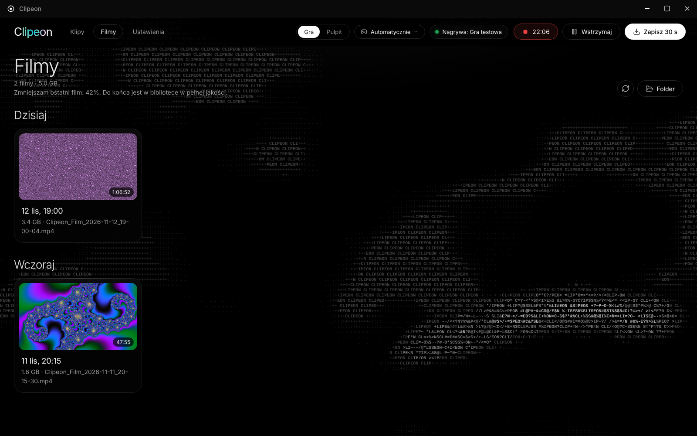

  

<h1 align="center">Clipeon</h1>

Zapisuj najlepsze momenty z gier jednym skrótem — bez nagrywania wszystkiego na dysk.

  
  

<table>
  <tr>
    <td width="33%">
Edytor
</td>
    <td width="33%">
Filmy
</td>
    <td width="33%">
Ustawienia
</td>
  </tr>
</table>

## Funkcje

- **Ostatnie sekundy gry jednym skrótem** — wciśnij **Alt+F10**, a ostatnie 30 s (do ustawienia od 5 s do 10 min) zapisze się jako MP4.
- **Filmy** — „Nagraj film” albo **Alt+F9** nagrywa bez limitu czasu, aż wciśniesz jeszcze raz. Film nie obciąża gry dodatkowo, a klipy działają w jego trakcie jak zwykle. Filmy mają własną zakładkę.
- **Mniejsze filmy** — po nagraniu Clipeon może w tle zapisać film od nowa jako HEVC (ok. połowa rozmiaru) albo AV1 (ok. jedna trzecia). Robi to karta graficzna.
- **Lekki** — obraz przechwytuje i koduje karta graficzna (AMD, NVIDIA, Intel), bez kopiowania klatek przez procesor; nic nie trafia na dysk, dopóki nie zapiszesz.
- **Tryb pulpitu** — przełącznik „Gra | Pulpit” na pasku: pulpit ma własny ekran i lżejsze ustawienia (domyślnie 30 FPS, 12 Mb/s), a ekran wybierzesz jednym kliknięciem.
- **Dźwięk gry i mikrofon osobno** — w edytorze dwie ścieżki z wykresem dźwięku: ściszysz albo wyciszysz jedno lub drugie i od razu to słychać.
- **Edytor** — przycinanie, kadrowanie, zmniejszanie do 10 / 20 / 50 / 100 MB i zapis jako zapętlony GIF / WebP, np. pod Discorda. Głośność słychać od razu, a `←` / `→` przewijają o 5 s, `,` / `.` o klatkę.
- **Przeciągnij i upuść** — gotowy klip przeciągasz prosto do Discorda, przeglądarki albo folderu.
- **Biblioteka** — klipy pogrupowane według dni, zaznaczanie wielu naraz, usuwanie do Kosza.
- **Czarny, spokojny wygląd** — w tle okna leżą znaki, a ruch myszki zostawia za sobą gasnącą smugę. Tło działa tylko przy otwartym oknie (w grze nie kosztuje nic) i da się je wyłączyć, tak jak kolory na napisie „Clipeon”.
- **Nie przestaje nagrywać po cichu** — sam wznawia nagrywanie po problemie ze sterownikiem, przechodzi na inny sposób przechwytywania, gdy któryś nie działa, i ostrzega, gdy coś jest nie tak.

## Wymagania

- Windows 10 (wersja 2004 lub nowsza) albo Windows 11, 64-bit
- Zalecana karta graficzna AMD Radeon RX 400+, NVIDIA GTX 600+ lub grafika Intel HD 500+ (bez niej Clipeon koduje procesorem)

## Szybki start

1. Pobierz `Clipeon_x.y.z_x64-setup.exe` z [najnowszego wydania](https://github.com/Atsuieon/Clipeon/releases/latest) i zainstaluj.
2. Clipeon działa w tle — ikona na pasku zadań, obok zegara. Kropka jest zielona, gdy nagrywa.
3. Graj i wciśnij **Alt+F10**, gdy wydarzy się coś wartego zapisania. Klik w ikonę otwiera bibliotekę klipów.
4. Chcesz nagrać całą rozgrywkę? Wciśnij **Alt+F9** na początku i jeszcze raz na końcu. Film znajdziesz w zakładce **Filmy**.

## Pytania

<b>Windows pokazuje „System Windows ochronił ten komputer”.</b>

Instalator nie jest podpisany płatnym certyfikatem, więc SmartScreen go nie zna. Kliknij **Więcej informacji → Uruchom mimo to**.
Instalator jest budowany automatycznie z kodu w tym repozytorium.

<b>Gdzie są moje klipy?</b>

W folderze `Wideo\Clipeon`, w podfolderze z miesiącem (np. `2026-11`); starsze klipy leżą prosto w folderze. Folder zmienisz w Ustawieniach.
Odinstalowanie nigdy nie usuwa klipów.

<b>Jak zmienić skrót?</b>

Ustawienia → Zapisywanie klipów → Skrót do zapisania klipu (albo Skrót do nagrywania filmu). Kliknij pole i wciśnij nową kombinację klawiszy.
Na czas ustawiania skróty Clipeona są wyłączone, więc nic się przy tym nie zapisze.

<b>Jak nagrać pulpit zamiast gry?</b>

Na pasku u góry okna kliknij **Pulpit** (albo w menu ikony na pasku zadań „Tryb: Pulpit”). Obok wybierzesz ekran.
Pulpit ma osobne ustawienia w Ustawieniach → Tryb pulpitu, więc przełączanie nie zmienia ustawień gry.
Klipy z pulpitu mają nazwy `Clipeon_Pulpit_…` i znaczek „Pulpit” w bibliotece.

<b>Filmy zajmują dużo miejsca.</b>

Ustawienia → Zapisywanie klipów → **Rozmiar filmów**: wybierz HEVC (ok. połowa rozmiaru) albo AV1 (ok. jedna trzecia).
Po zakończeniu nagrania Clipeon zapisze film od nowa w tle, a do tego czasu film leży w bibliotece w pełnej jakości.
Pod listą widać, ile zajmie godzina filmu. Opcje pojawiają się tylko wtedy, gdy Twoja karta graficzna umie dany format.

<b>Coś nie działa — jak zgłosić błąd?</b>

Ustawienia → Zaawansowane → Zgłaszanie problemów → **Kopiuj diagnostykę** i wklej tekst do [zgłoszenia](https://github.com/Atsuieon/Clipeon/issues/new/choose).
Diagnostyka opisuje kartę graficzną, monitory, ustawienia i ostatnie zdarzenia. Nic nie jest wysyłane automatycznie.

<b>Używałem Clippera — co teraz?</b>

Clipeon to ta sama aplikacja pod nową nazwą. Zainstaluj go: instalator sam usunie Clippera, a ustawienia, autostart i klipy zostaną.

**Prywatność:** wszystko zostaje na Twoim komputerze — jedyne połączenie z internetem to sprawdzanie aktualizacji na GitHubie (można wyłączyć).

## English

Clipeon keeps the last seconds of your gameplay in memory and saves them as an MP4 when you press **Alt+F10**;
**Alt+F9** starts and stops a long recording with no time limit, which can then be re-encoded to HEVC or AV1 in the background to save space.
GPU capture and encoding (AMD / NVIDIA / Intel), a desktop recording mode, separate game and mic tracks, trimming, shrink-to-size for Discord,
drag-and-drop clips into other apps. Windows 10 2004+ / 11. [Download the latest release](https://github.com/Atsuieon/Clipeon/releases/latest)
— the installer is unsigned, so SmartScreen may warn: *More info → Run anyway*. The interface is in Polish.

## Licencja

[MIT](LICENSE) © 2026 Atsuieon. FFmpeg w instalatorze: LGPL 2.1+ — zob. [THIRD_PARTY_NOTICES.md](THIRD_PARTY_NOTICES.md).
